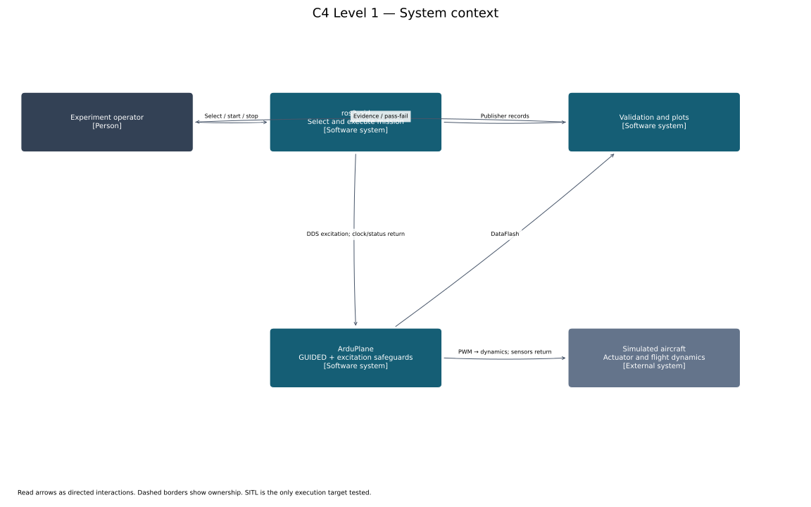
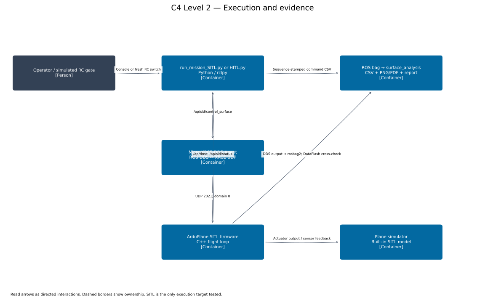
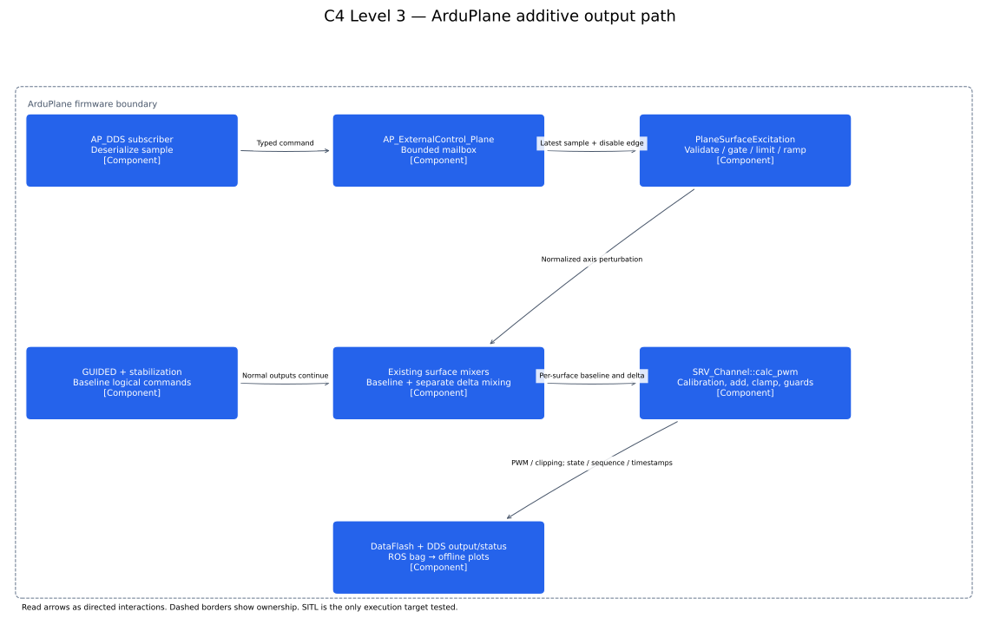

# GUIDED control-surface excitation

This feature adds normalized control-surface perturbations to normal ArduPlane
GUIDED outputs. It does not send attitude targets, replace stabilization, or command
raw PWM from ROS. Use the existing **ros2_sid mission entrypoints**.

## Read the architecture

Start with the context diagram, then follow the command path through containers and
firmware components. Arrows describe interactions; dashed borders indicate ownership.





Editable diagram source: [render_c4.py](render_c4.py). Run with Python and matplotlib
to regenerate SVG/PNG files. See [ARCHITECTURE.md](ARCHITECTURE.md) for the injection
tradeoff and phase verification gates.

## Build

From `ardupilot_sid`, initialize submodules and use a supported Python environment
with `empy==3.3.4`, `future`, `lxml`, `pyyaml`, `dronecan`, and `pexpect`. Put the
workspace's built Micro-XRCE-DDS-Gen `scripts` directory on PATH.

```bash
git submodule update --init --recursive
./waf configure --board sitl --enable-dds
./waf plane -j4
```

Build the ROS packages in a ROS 2 Humble environment:

```bash
source /opt/ros/humble/setup.bash
cd /tmp  # Matches the automated runner's /tmp/install workspace
colcon build --base-paths /work/ardupilot_sid/Tools/ros2/ardupilot_msgs \
  /work/ardupilot_sid/Tools/ros2/ardupilot_sitl /work/ros2_sid/ros2_sid \
  --packages-select ardupilot_msgs ardupilot_sitl ros2_sid \
  --cmake-args -DARDUPILOT_PLANE_ONLY=ON
source install/setup.bash
```

If firmware was already built with the Waf command above, add
`-DARDUPILOT_SKIP_BUILD=ON` to install the existing Plane binary and launch files.
The plotting tools also require NumPy, SciPy, matplotlib, and pymavlink.


IDL files live in `libraries/AP_DDS/Idl/ardupilot_msgs/msg`; Waf generates the C
serializers. ROS `.msg` files live in `Tools/ros2/ardupilot_msgs/msg`.

## Isolated SITL services

From the outer workspace, the supplied Compose file uses existing local ROS/agent
images and no hardware device mappings:

```bash
docker compose -f docker-compose.sid.yaml up -d
```

For two containers sharing host networking, use the supplied UDP-only Fast DDS
profile to avoid shared-memory discovery succeeding while data delivery fails:

```bash
export ROS_DOMAIN_ID=0
export FASTRTPS_DEFAULT_PROFILES_FILE=/work/ros2_sid/ros2_sid/config/surface_excitation/fastdds_udp.xml
```

Use the Micro XRCE-DDS Agent on UDP port **2021**, matching the sample firmware
parameters. The firmware in this fork has two existing 60-second startup delays;
allow more than two minutes for DDS readiness. `ros2 topic list` alone is insufficient:
check that `/ap/time` and `/ap/sid/output` actually deliver samples.

Run the firmware from a dedicated output directory, using absolute paths:

```bash
/path/to/ardupilot_sid/build/sitl/bin/arduplane \
  --model plane --speedup 1 --wipe \
  --home=-35.362938,149.165085,584,353 \
  --serial0 tcp:5780 --serial1 tcp:5782 \
  --defaults /path/to/ardupilot_sid/Tools/autotest/models/plane.parm,/path/to/ardupilot_sid/Tools/ros2/ardupilot_sitl/config/surface_excitation/conventional.parm
```

The `plane_excitation.launch.py` launch file also selects `arduplane` explicitly.
Pass both base Plane defaults and excitation defaults with its `defaults` argument.
For V-tail/elevon, replace `conventional.parm` with the corresponding complete
parameter file and select `plane-vtail`
or `plane-elevon`. Do not use Copter defaults.

## Run a mission

DDS missions explicitly declare `"units": "normalized_surface"`. Existing attitude
missions using radians are rejected by this backend. Each JSON experiment specifies
`duration`, `rate`, and either per-axis generated signals or a CSV path. CSV columns
are `time,roll,pitch,yaw`; times start at zero and increase. The fixed-rate sampler
interpolates CSV values at monotonic experiment time; it does not replay late rows.

```bash
ros2 run ros2_sid run_mission_SITL.py --interface dds \
  --experiment /work/ros2_sid/ros2_sid/config/surface_excitation/chirp.json \
  --command-log chirp-commands.csv
```

Use console `start`, `stop`, or `quit`. Add `--autostart` for automated SITL runs.
The feature must already be enabled, normally armed, airborne, and in GUIDED
(see `SX_GND_TEST` below for ground-only testing).
The publisher waits for firmware authorization and synchronized AP time. Each
publisher starts a new randomized sequence epoch and waits for acknowledgment of
one of its own disable samples before enabling. A previous publisher's ARMED status
is insufficient. Missing enable acknowledgment aborts the waveform within 200 ms.

```bash
ros2 run ros2_sid run_mission_HITL.py --interface dds \
  --experiment /work/ros2_sid/ros2_sid/config/surface_excitation/multisine.json \
  --rc-channel 7 --rc-threshold 1800 --rc-timeout 0.5
```

HITL DDS mode uses `/ap/rcin` with validity-mask checks and requires a fresh low-to-high
switch transition. High-at-startup, invalid channels, or stale RC data cannot authorize
it. Automated tests use simulated RC input; physical-aircraft testing is excluded.
Legacy `--interface trajectory` (also the backward-compatible default) preserves the
existing mission-library/attitude workflow. The two interfaces never publish together.
DDS waveform configuration is independent of `drone_ros`.

Multisine maneuvers are available in both mission entrypoints. `multisine.json`
combines a roll multisine with constant pitch/yaw offsets; `multisine_all_axes.json`
uses independent component frequencies and phases on all three axes. Each axis has
a conservative sum-of-absolute-component-amplitudes bound of 0.10. Frequencies are
in Hz and phases in radians. These are normalized surface perturbations, not attitude
commands. The aircraft response remains a closed-loop response with stabilization active.

Select a maneuver interactively with `list`, `select N`, and `start`:

```bash
ros2 run ros2_sid run_mission_SITL.py --interface dds \
  --mission-plan /work/ros2_sid/ros2_sid/config/surface_excitation/mission_plan.json
```

For an automated SITL run, use `--experiment` with `multisine_all_axes.json` and
`--autostart`. Record the bag as below to compare requested commands, actual applied
PWM perturbations, and attitude/angular-rate responses offline. Simultaneously
exciting several axes requires multivariable identification; a per-axis spectral
plot alone does not establish a causal single-input transfer function.

## Record a bag and replot offline

Record before starting the mission; stop recording with Ctrl-C after the return ramp:

```bash
ros2 run ros2_sid record_surface_excitation.sh bags/chirp
ros2 bag info bags/chirp
ros2 run ros2_sid plot_surface_excitation.py bags/chirp --output plots/chirp
# Optional exact boot-time/channel comparison against firmware logs:
ros2 run ros2_sid plot_surface_excitation.py bags/chirp --output plots/chirp \
  --compare-dataflash logs/00000001.BIN --command-log chirp-commands.csv
```

The recorder saves `/ap/time`, `/ap/sid/control_surface`, `/ap/sid/status`, and
`/ap/sid/output`, with explicit best-effort/volatile QoS. `output` is a coherent
firmware snapshot containing boot and AP-clock timestamps, sequence, state, mode,
calibration, baseline/final PWM, physical normalized excitation, actual PWM delta,
clipping, attitude, angular rates, and airspeed. Arrays use zero-based physical servo
indices; plots label them as one-based `SERVOx` channels.

**Offline plotting reads rosbag2 directly; no running aircraft, publisher, or bag
playback is needed.** Keep the matching `ardupilot_msgs` package with archived bags.
The tool also accepts a DataFlash `.BIN` for an independent firmware-side check.

Outputs:

- `excitation_tracking`: requested versus limited logical excitation and state.
- `actuator_validation`: baseline, expected and final PWM; reconstruction error.
- `aircraft_response`: applied physical delta, attitude, angular rates, airspeed.
- `frequency_response_servo*`: descriptive closed-loop gain/phase/coherence when enough
  samples exist. Simultaneous correlated inputs do not constitute independent MIMO identification.
- `actuators.csv`, `aligned_response.csv`, and `report.json` with numeric verification.

A 10% non-reversed perturbation at MIN=1100/TRIM=1500/MAX=1900 gives +40 µs;
with baseline=1600, final PWM is 1640. Mixing combines axes before converting the
perturbation. Reversal is applied once. Final saturation can reduce the actual delta.
Plots show commanded actuator PWM, not measured physical deflection. Firmware
anti-windup is unchanged and does not directly observe this added saturation.

## Parameters and authorization

| Parameter | Default | Meaning |
|---|---:|---|
| SX_ENABLE | 0 | Feature opt-in; startup still requires disable then enable |
| SX_GND_TEST | 0 | 0 requires airborne normal flight; 1 requires grounded detection; other values reject excitation |
| SX_R_MAX / SX_P_MAX / SX_Y_MAX | 0.10 | Per-axis normalized bounds, range 0–1 |
| SX_S_MAX | 0.20 | Mixed per-surface normalized bound, range (0,1] |
| SX_TIMEOUT | 200 | Command freshness in ms, range 20–2000 |
| SX_RETURN | 200 | Timeout/command-disable return in ms, range 0–2000 |
| SX_SLEW | 0 | Optional normalized units/s slew, 0 disables, range 0–100 |

States: 0 DISABLED, 1 ARMED (experiment-ready, distinct from vehicle arming),
2 ACTIVE, 3 TIMEOUT, 4 FAULT. Reasons: 0 NONE, 1 UNAUTHORIZED, 2 INVALID,
3 STALE, 4 ORDER, 5 CONFIG, 6 CLOCK, 7 DISCONNECTED, 8 OVERRIDE.

Normal-flight GUIDED, armed/safety-off, flying, and no failsafe are required by default.
`SX_GND_TEST=1` replaces only the flying/normal-flight-stage requirement with
grounded detection. Use it with the ROS `--no-straight-flight` flag to skip
navigation preparation and LOITER recovery. All other authorization checks,
watchdogs and surface limits remain active. Isolate propulsion before arming;
restore `SX_GND_TEST=0` before flight. See the
[ground-test procedure](../../../ros2_sid/ros2_sid/docs/manual_surface_excitation_hitl.md#ground-tests-with-physical-control-surfaces).
This
implementation conservatively excludes all QuadPlane configurations, servo auto-trim,
active navigation scripting, unsupported surface functions, and configured scripting
outputs. Conventional, repeated aileron/elevator/rudder, flaperon, V-tail and elevon
outputs are supported. Changing live servo/mixer configuration invalidates authorization.
Timeout and explicit disable ramp to zero; loss of authorization removes excitation
immediately. Recovery requires a fresh disable/enable sequence. A reboot never retains
runtime authorization. Use one DDS publisher per vehicle; ordering is not authentication.

## Verification

Standalone engine test:

```bash
g++ -std=c++11 -Wall -Wextra -Werror libraries/AP_SurfaceExcitation/tests/state_test.cpp -o /tmp/surface-state-test
/tmp/surface-state-test
./waf --targets tests/test_surface_excitation
build/sitl/tests/test_surface_excitation
```

ROS unit tests:

```bash
PYTHONPATH=/work/ros2_sid/ros2_sid:$PYTHONPATH python3 -m pytest /work/ros2_sid/ros2_sid/tests/test_surface_signals.py /work/ros2_sid/ros2_sid/tests/test_surface_analysis.py /work/ros2_sid/ros2_sid/tests/test_surface_mission_ros.py
```

The host-side `Tools/ros2/ardupilot_dds_tests/scripts/surface_sitl.py` owns a fresh
SITL process and takes off without forced arming, runs chirp, roll multisine, and
independent all-axis multisine experiments,
records a ROS bag, and exercises DDS rejection/timeout/calibration/mode behavior.
It expects a ROS container named `sid-validation`, source-built packages at
`/tmp/install`, and the outer workspace mounted at `/work`; `--container` overrides
the name (the Compose service is normally `surface-excitation-sitl-ros-1`). It uses
ports 5780/5782 and the isolated agent above. Run from `ardupilot_sid`:

```bash
python3 Tools/ros2/ardupilot_dds_tests/scripts/surface_sitl.py \
  --container surface-excitation-sitl-ros-1 --airframe conventional --rate 50 \
  --output ../sid_results/conventional
```

Select `--airframe vtail` or `--airframe elevon` for mixed surfaces. Omit `--rate`
to use each example's 100 Hz cadence. The runner stores the exact merged firmware
parameters and waveform JSON in the output directory. A scheduling abort is a
failed experiment; a lower explicitly configured rate may be appropriate for a
shared development host, without weakening the two-period jitter safeguard.

The runner validates each command CSV against bag output: at least 95% of observed
frames must be ACTIVE, active output must span at least 90% of the commanded duration,
observed active-frame gaps must not exceed 200 ms, and accepted-sequence logical
axes must match. These checks complement per-servo
PWM reconstruction and exact DataFlash matching. The supplied examples use no
active slew and remain within axis limits; intentional clipping/slew experiments
need an appropriately modeled logical-command comparison.

Retain failed-run artifacts as well as passing results. Firmware/ROS build success or
message reception alone is not experiment acceptance. See the verification report for
checks actually executed and remaining limitations.

## Python maintenance

The new `ros2_sid` modules have typed public interfaces and docstrings, and pass
Ruff format/lint/docstring/annotation checks and mypy. See
`ros2_sid/ros2_sid/README_surface_excitation.md` in the outer workspace for exact
commands and the narrow typing allowances for external ROS-generated classes.
Raw commands with unusable source timestamps are plotted at estimated bag receipt
time and counted as `commands_using_receipt_time`; they do not alter applied-output
or complete-maneuver validation. Applied frames are always sorted by firmware time.
