# Implementation and verification record

## Delivered implementation

See [architecture](ARCHITECTURE.md), [usage/build/launch instructions](README.md),
and the [modified-file inventory](MODIFIED_FILES.txt). C4 context, container and
component diagrams are available as SVG/PNG with editable `render_c4.py` source.

GUIDED stabilization and baseline surface mixing continue normally. The Plane-owned
engine computes separate logical perturbations with the existing mixer arithmetic.
`SRV_Channel::calc_pwm()` uses live MIN/MAX/TRIM/REVERSED values to convert each
physical contribution, add it to baseline PWM, and constrain the result. Zero
perturbation preserves the original path. Overrides/emergency stop take precedence;
a conflicting override rejects the whole excitation vector. No raw PWM command is
exposed. Conventional, duplicated, flaperon, V-tail and elevon functions are mapped;
unsupported control-surface/scripted functions inhibit activation.

`ControlSurfaceExcitation` carries sequence, enable, AP-clock stamp and normalized
roll/pitch/yaw on `/ap/sid/control_surface`. Status and coherent physical-output
snapshots use `/ap/sid/status` and `/ap/sid/output`. DataFlash records commands,
state, baseline/applied outputs, clipping and live calibration. The ROS publisher
belongs to `ros2_sid`; both existing mission entrypoints select it with
`--interface dds`. Legacy trajectory behavior is retained.

The ROS modules have documented, typed public interfaces, named firmware states,
validated waveform specifications and standard formatting. See
`ros2_sid/ros2_sid/README_surface_excitation.md` in the outer workspace for quality
checks. Multisine examples include roll with pitch/yaw offsets and independent
multisines on all three axes. Mission selection uses the existing SITL/HITL scripts.

## Executed checks

| Check | Result |
|---|---|
| ArduPlane SITL, DDS enabled | Build passed, including the final configuration-logging fix |
| ArduPlane SITL, DDS disabled | Build passed after the same fix |
| Standalone C++ engine | Assertions passed with `-Wall -Wextra -Werror` |
| Real SRV_Channel gtests | Four passed: calibrated addition/no latch, asymmetry/reversal, saturation/duplicates/E-stop, whole-vector override rejection |
| Existing DDS tests | Time conversion and external odometry tests passed |
| ROS interfaces and publisher | `colcon build` passed |
| Plane launch package | Plane-only prebuilt-firmware installation passed; installed launch arguments resolve model/default parameter files |
| Python/ROS regressions | 21 pytest cases passed, none skipped |
| Colcon/CTest registration | 24 reported results: 21 cases plus three CTest wrappers; no errors, failures or skips |
| Python style | Ruff 0.17.1 formatting, lint, annotation and docstring checks passed |
| Python typing | Mypy 2.4.0 strict checks passed with documented external ROS import/subclass allowances |

Engine tests cover startup authorization, limits, invalid/stale/ordered samples,
wraparound, timeout/disable ramps, simultaneous axes, authorization loss, and
clock/disconnect/config/override fault reactivation. ROS tests cover waveform math,
combined multisine bounds, independent axes, cadence, stale/jumping clocks, RC gating,
shutdown, publisher-restart acknowledgment and offline validation failures.

## Final airborne SITL experiments

All three final runs completed normal takeoff and airborne fixed-wing GUIDED with
firmware safety gates enabled. Each ran a 10-second chirp, 12-second roll multisine,
and 20-second independent three-axis multisine, followed by the safety probe.

| Airframe / retained directory | Publish rate | Actuator samples | Maximum PWM reconstruction error | Exact bag/DataFlash matches | Applied spans: chirp / roll multisine / three-axis multisine |
|---|---:|---:|---:|---:|---|
| `conventional_50hz` | 50 Hz | 9,618 | 1 µs | 9,618 / 9,618 | 9.94 / 11.96 / 19.96 s |
| `vtail_acknowledged` | 100 Hz | 9,669 | 1 µs | 9,669 / 9,669 | 9.96 / 11.94 / 19.94 s |
| `elevon_50hz` | 50 Hz | 9,638 | 1 µs | 9,638 / 9,638 | 9.98 / 11.96 / 19.94 s |

No calibration was missing. Accepted-sequence logical axes matched the publisher
CSV without mismatches. Active coverage exceeded 99.7% of observed waveform frames;
maximum observed active-frame gaps were below 41 ms. Bag/DataFlash matching checks
firmware timestamp, channel, sequence, revision, baseline, actual delta and final PWM.
The independent physical reconstruction uses calibration/reversal and baseline,
with at most one microsecond of integer-conversion difference. The live probe
independently checks the mixer equations before checking calibrated output.

The safety probe passed on each final airframe: simultaneous calibrated outputs,
duplicate-command timeout, stale timestamps, nonfinite/out-of-range values,
explicit disable, silence timeout, mode-change removal, live duplicated-channel
mapping/calibration/reversal, and invalid-calibration inhibition. The controller
continues producing baseline outputs throughout. Unit tests verify the disabled
servo path exactly; aircraft trajectories are not compared after excitation.

A separate DataFlash-only reconstruction of `vtail_combined` passed for 29,398
actuator samples, with maximum PWM error 1 µs and complete configuration. This
checks firmware logging independently of the bag but does not make that older run
a successful complete-waveform experiment (see below).

## Individual-axis chirp and multisine flights

Six new conventional-airframe SITL experiments were executed sequentially in airborne
GUIDED, at simulation speed 1 and 50 Hz publication. Only the named axis was excited;
the other two normalized commands, applied logical excitations and physical PWM
perturbations were verified to be zero throughout each plotted experiment window.
Normal controller outputs and cross-axis aircraft responses remain present.

- **Chirps:** 0.10 normalized amplitude, linear sweep from 0.2 to 3 Hz over 10 s.
- **Multisines:** 0.5, 1 and 2 Hz components; amplitudes 0.03, 0.03 and 0.04;
  phases 0, 1 and 2 radians; 12 s duration. The sum-of-amplitudes bound is 0.10.
- **Validation:** all six full-duration/accepted-sequence checks passed. All 14,608
  actuator samples in the complete recording matched DataFlash exactly, with
  independent calibrated-PWM reconstruction error at most 1 µs and no missing
  calibration. The recording also contains the subsequent safety probe, which passed.
- **Retained data:** `sid_results/individual_axes/` in the outer workspace contains
  the ROS bag, DataFlash log, six exact waveform JSON files, command CSVs, process
  logs, and aggregate `plots/report.json`. Figures below are saved with this report
  as PNG/PDF; [plot summary](figures/individual_axes/summary.json) records the
  per-experiment zero-other-axis checks; the [validation report](figures/individual_axes/validation.json) retains the numerical acceptance results.

| Experiment | Observed active span | Active observed frames | Maximum output-frame gap | Result |
|---|---:|---:|---:|---|
| chirp roll | 9.960 s | 100.00% | 40.82 ms | Passed |
| multisine roll | 11.960 s | 100.00% | 39.98 ms | Passed |
| chirp pitch | 9.940 s | 100.00% | 39.98 ms | Passed |
| multisine pitch | 11.939 s | 99.81% | 39.98 ms | Passed |
| chirp yaw | 9.940 s | 100.00% | 40.82 ms | Passed |
| multisine yaw | 11.939 s | 100.00% | 40.82 ms | Passed |

Each figure shows requested versus applied logical excitation, actual additive PWM
on all three control surfaces, all three body angular rates, and the selected-axis
attitude change. Time is aligned using the firmware/AP clock. Vertical lines mark
the first and last enabled command samples; the following interval shows removal
of the perturbation. Attitude is unwrapped and referenced to the first plotted
sample. GUIDED's nominal motion has not been subtracted, and rates/angles are
recorded responses rather than a claim of isolated open-loop dynamics.

### Roll only

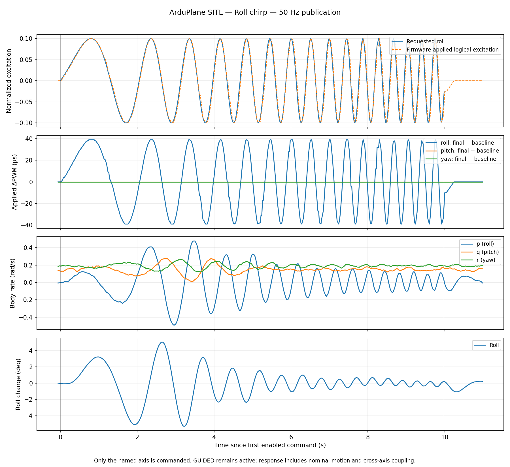

[Download roll chirp PDF](figures/individual_axes/chirp_roll.pdf)

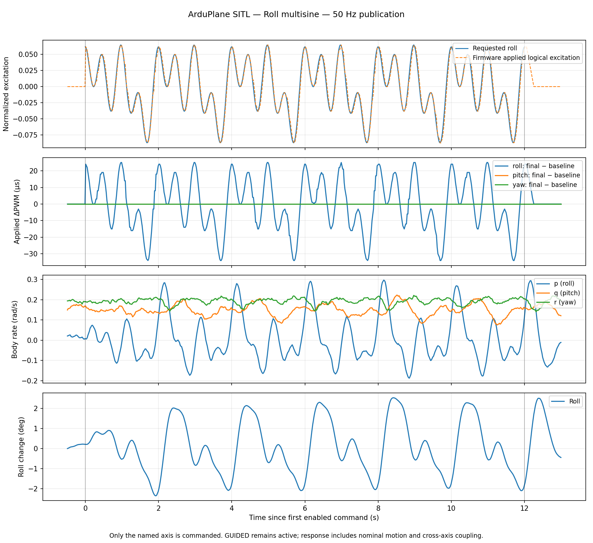

[Download roll multisine PDF](figures/individual_axes/multisine_roll.pdf)

### Pitch only

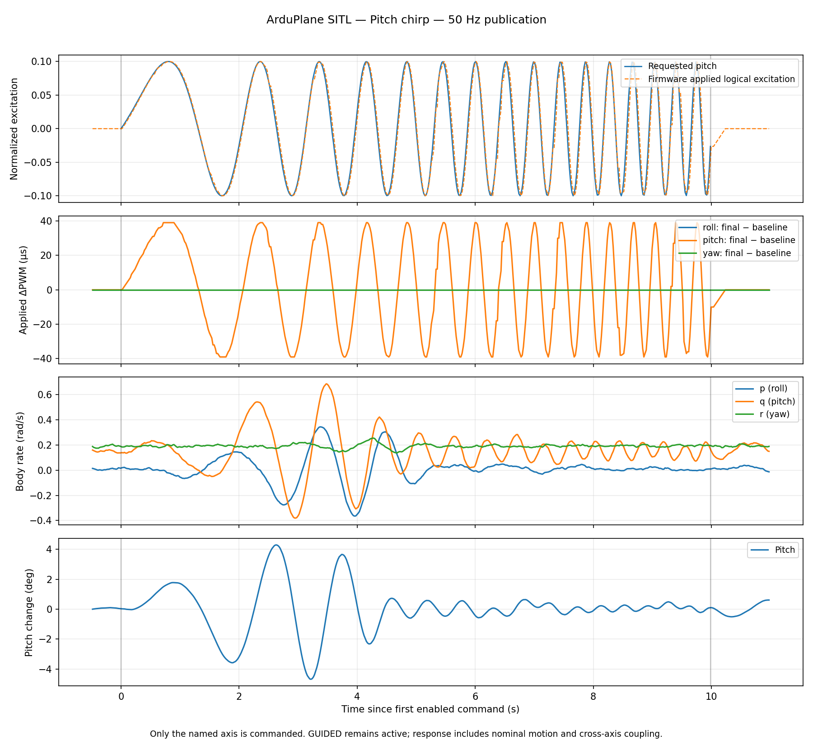

[Download pitch chirp PDF](figures/individual_axes/chirp_pitch.pdf)

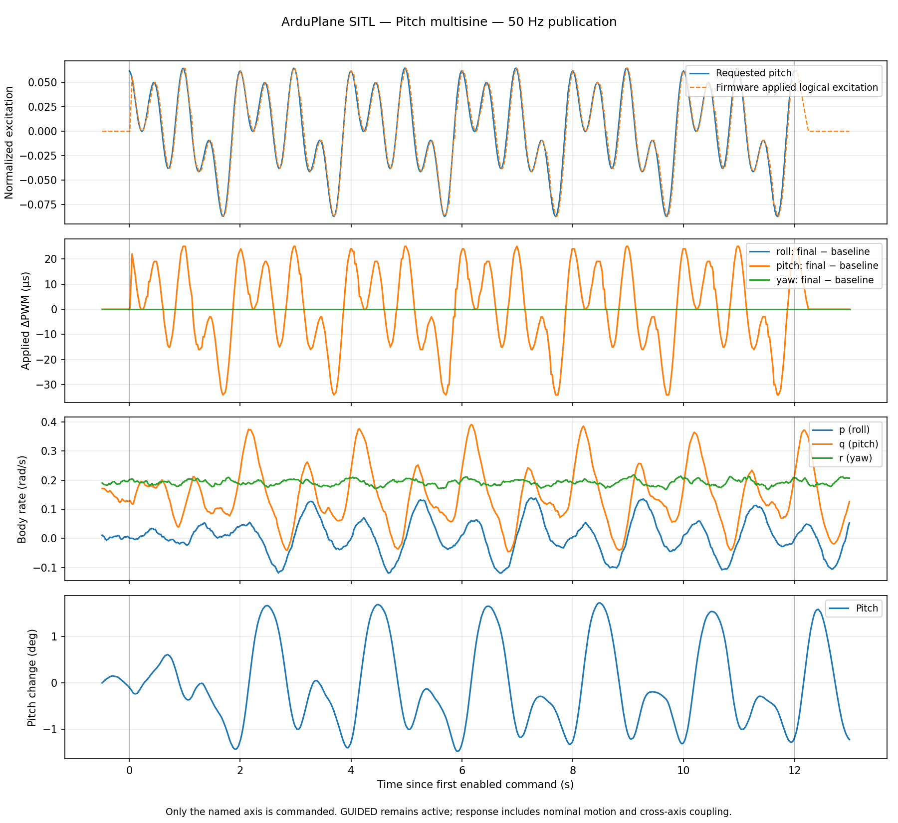

[Download pitch multisine PDF](figures/individual_axes/multisine_pitch.pdf)

### Yaw only

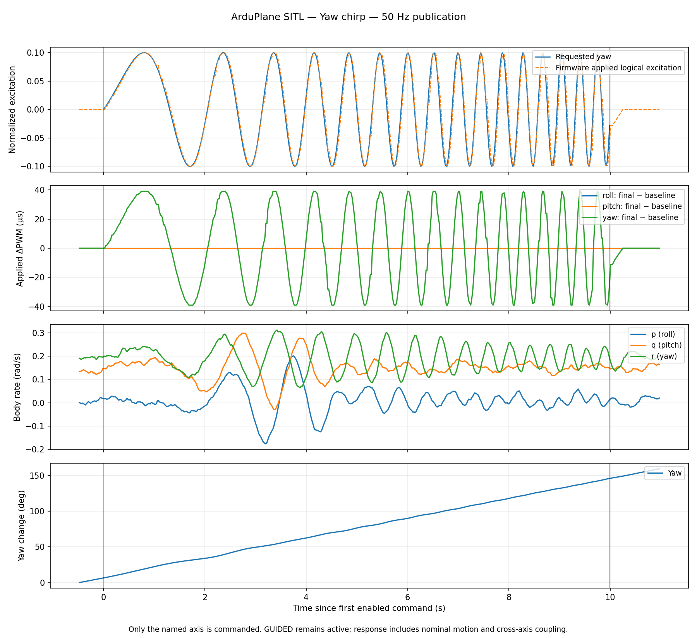

[Download yaw chirp PDF](figures/individual_axes/chirp_yaw.pdf)

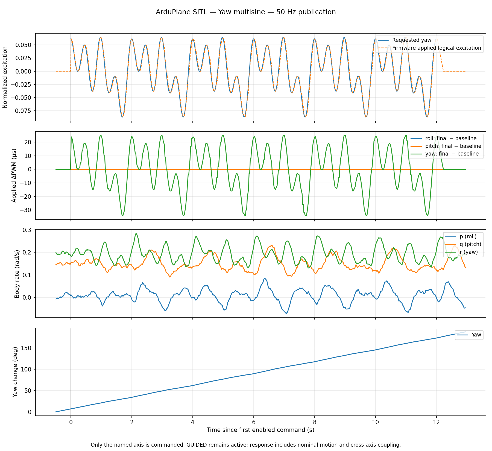

[Download yaw multisine PDF](figures/individual_axes/multisine_yaw.pdf)

Reproduce the flights with the runner's `--individual-axes --rate 50` options.
Replot the same bag using `python3 -m ros2_sid.surface_axis_plots --run RUN_DIRECTORY
--output FIGURE_DIRECTORY` after sourcing the ROS workspace; detailed commands are
in `ros2_sid/ros2_sid/README_surface_excitation.md` in the outer workspace.

## Artifacts and reproducibility

All paths below are relative to the outer workspace; large artifacts are excluded
from version control and retained locally under `sid_results/`.

Each final directory contains the ROS bag, firmware `.BIN`, publisher command CSVs,
launch/process logs, `execution.json`, and `plots/` with PNG/PDF figures, actuator
CSV, aligned response CSV and `report.json`. The final conventional/elevon runner
also retains merged parameter defaults and exact waveform JSON. The V-tail run
used the checked-in 100 Hz examples. Build and ROS-test logs are retained in
`sid_results/verification/`.

The README supplies exact Waf, colcon, launch, bag-record and replot commands.
The recorded tests used ROS Humble, domain 41, UDP agent port 2021 and the UDP-only Fast DDS
profile. Simulation speed was 1. No physical devices were mapped or aircraft flown.

Earlier runs are retained as failed/diagnostic evidence. A publisher-restart race
allowed an old ARMED status to bypass the new disable acknowledgment; the
`vtail_combined` roll multisine applied only 1.68 of 12 seconds. It is **not** a
complete-maneuver pass despite correct scaling. The publisher now acknowledges its
own randomized sequence epoch, and duration/axis checks reject this failure.
A later 100 Hz conventional run aborted on excessive jitter; its failure is
retained. The final conventional/elevon runs explicitly use 50 Hz without weakening
the two-period jitter safeguard. Earlier startup DataFlash logs lacked calibration;
periodic configuration logging fixes reconstruction. Mixed defaults are merged to
avoid this fork's deferred DDS-parameter loading issue.

## Limits and checks not exercised

- This is development/SITL evidence, not physical-aircraft qualification. PWM is a
  commanded output, not measured surface position.
- Controller anti-windup does not directly observe the additional actuator clipping.
  Spectral plots describe closed-loop response; correlated multi-axis inputs need
  multivariable identification before attributing a transfer function to one axis.
- All QuadPlane configurations, servo auto-trim, active navigation scripting and
  unsupported mixers are conservatively excluded. One command publisher is assumed;
  sequence ordering is not authentication.
- Live DDS agent reconnection, a live AP-clock discontinuity, every failsafe combination,
  dedicated flaperon flight dynamics and hardware timing/load limits were not
  exercised. Core clock/disconnect fault and reactivation paths are unit-tested;
  this does not substitute for those live integration cases.
- Clean-machine container image construction remains unverified: Compose uses
  existing local ROS/agent images. Host-native ROS checks were unavailable and ran
  in Docker instead. The fork retains two existing 60-second DDS startup delays.
- The broad original verification matrix is therefore not fully closed. Only checks
  listed as executed above are claimed as passed.

The current Compose setup, SITL parameter examples, and usage guides now use domain
0. Archived runs retain their original domain 41 configuration; the flight experiments
have not been rerun solely for this domain change.

## Shared legacy-layout library and interactive console verification

The DDS and trajectory entrypoints now share
`ros2_sid/setup/mission_library/current_mission.json` → `subfolder` →
`mission_plan.json` → CSV files ordered by `order`. The selected `dds_surface`
mission contains six normalized-surface chirp/multisine CSVs. Backend unit checks
reject use of surface plans in trajectory mode and attitude plans in DDS mode.
Explicit DDS JSON overrides remain available.

Executed the real `run_mission_SITL.py --interface dds` console via stdin with
`list`, `select N`, `start`, `stop`, and `quit`, without a source argument or
`--autostart`. All six roll/pitch/yaw chirp/multisine maneuvers completed airborne
in GUIDED at 50 Hz. The safety probe and mode-change checks also passed.

The saved bag passed calibrated-output, full-maneuver, and exact DataFlash checks:
15,360 actuator samples, maximum reconstruction error 1 microsecond, zero missing
configuration, and 15,360 exact DataFlash matches with zero missing/mismatched rows.
See [numeric validation](interactive_library_validation.json).
The package build, 27 Python regression tests, and new-code lint checks passed.

Artifacts are retained at `sid_results/interactive_library_20261021_retry/`:
all-topic ROS bag, `.BIN`, command CSVs, the selected mission-library snapshot,
console transcripts, execution results, `plots/`, and `analysis-rerun.txt`.
The initial offline analysis lacked matplotlib; it was installed in the test
container and analysis was successfully rerun on the same recordings. Preserve
analysis dependencies in your ROS image when recreating the environment.

Earlier attempts are retained under `interactive_library_20261021*`: the first
encountered another simulator's serial-port conflict; later attempts exposed a
console shutdown bug (fixed by avoiding buffered stdin locks) and a two-period
publication-jitter abort. The jitter safeguard was not relaxed. The final run
used a dedicated DDS agent at UDP 2022/domain 42 to coexist with the existing
simulator; normal configuration remains domain 0/UDP 2021. No physical flight
was performed. The test agent was stopped after verification.

Reproduction (with a matching dedicated agent already running):

```bash
python3 ardupilot_sid/Tools/ros2/ardupilot_dds_tests/scripts/surface_sitl.py \
  --container surface-excitation-sitl-ros-1 --interactive-library --rate 50 \
  --dds-domain 42 --dds-port 2022 --output sid_results/NEW_console_run
```

## Straight-flight coordination and safe exit (2026-10-21)

Implemented the optional ROS-only `--straight-flight` coordinator. MAVROS sets a
fixed ground course, relative altitude, and airspeed; DDS remains the additive
surface-excitation transport. The operator must already have taken off and entered
GUIDED. The coordinator waits for a continuous settling dwell before enabling the
selected CSV, and does not refresh navigation targets during ACTIVE.

Legacy `maneuver_stop()` stopped publishing and reset the maneuver; it did not
explicitly request LOITER. The new option preserves revocation of publishing and
adds repeated disable, fresh zero-contribution observation, and confirmed LOITER
recovery while the vehicle remains armed and authorized in GUIDED. Operator mode
changes, disarm, and critical vehicle status take precedence. Unconfirmed recovery
is a reported failure. A process/host kill or lost communication cannot guarantee
a navigation handoff; firmware timeout still removes stale excitation.

### Executed normal maneuvers

`sid_results/straight_verified_20261021/` retains all six complete CSV maneuvers:
10-second chirps and 12-second multisines separately on roll, pitch, and yaw,
through the actual manual console at 50 Hz and simulation speed 1. Each completed
settling, ACTIVE, return-to-zero, and confirmed LOITER.

Offline ROS bag analysis passed:

- 27,705 actuator samples; maximum calibrated PWM reconstruction error 1 µs.
- 27,705 exact DataFlash matches; no missing or mismatched samples.
- All six full-maneuver command/application checks passed.
- All six event-based settling-dwell, fixed-target, zero-before-turn, and LOITER
  checks passed. Event evidence is sampled at 10 Hz; the live gate runs at mission cadence.
- Maximum ACTIVE bank magnitude 3.72 degrees; maximum course error 0.84 degrees
  across these runs. These are observed SITL results, not universal thresholds.

See [numeric results](straight_flight_validation.json). The artifacts include
all-topic rosbag2, `.BIN`, command CSVs, coordinator JSONL, mission-library snapshot,
console/MAVROS logs, and `plots/`. `analysis-rerun.txt` records the successful offline
analysis. The run's overall `execution.json` retains a failed **separate safety
probe**: it attempted to share MAVROS's TCP endpoint. Do not interpret that entry
as a passing safety-probe test. The harness now provides the probe its own SERIAL2
MAVLink port; its rerun is reported separately below.

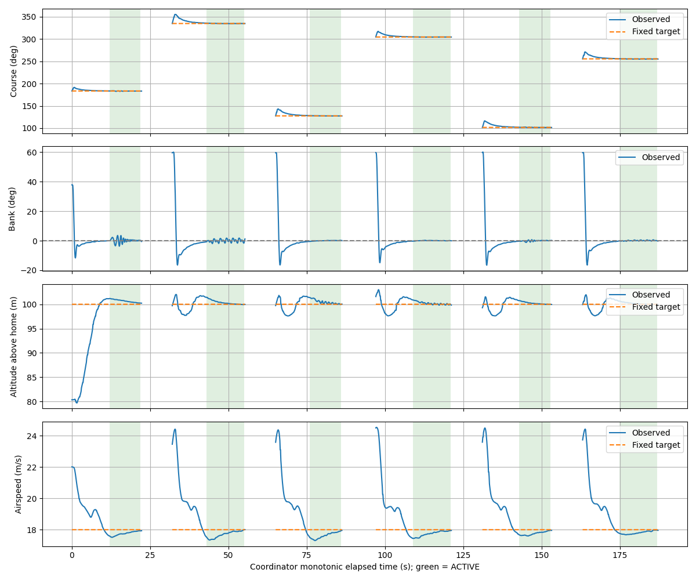

Green windows mark ACTIVE excitation. Plot gaps separate mission processes and
unobserved recovery intervals; they do not imply zero altitude or instantaneous
flight paths. The recovery turns are excluded from the identification windows.

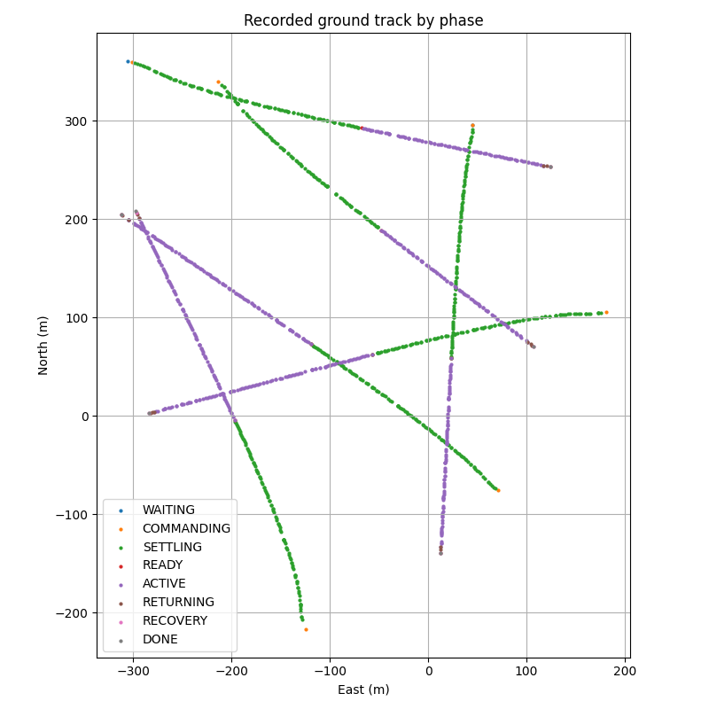

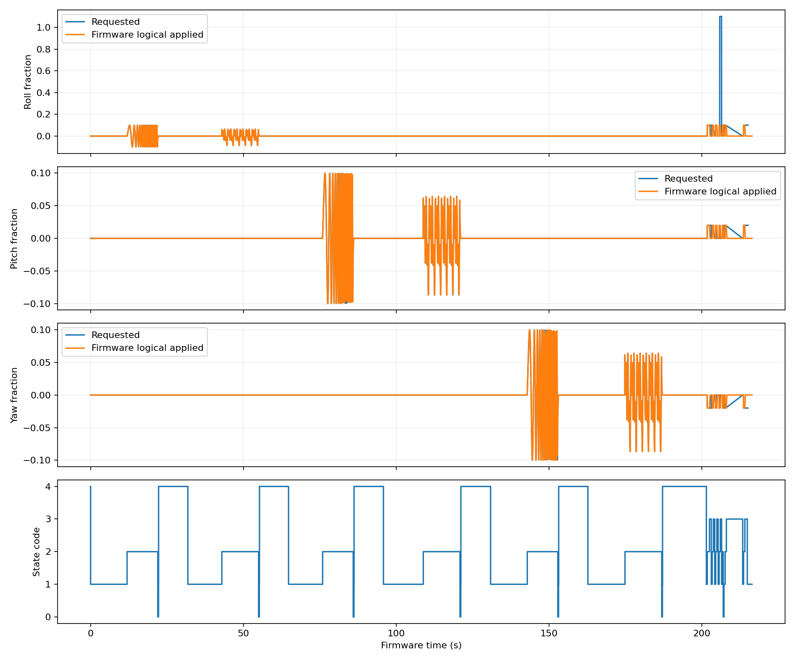

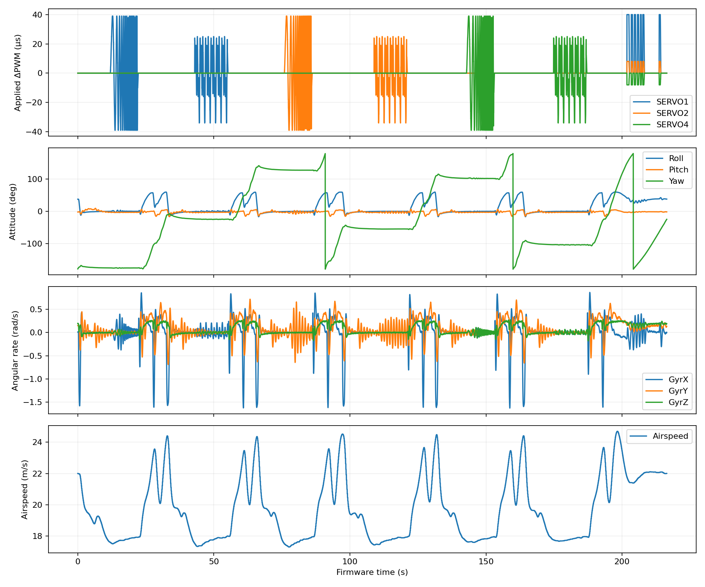

[Baseline/final PWM and reconstruction errors](straight_flight_figures/actuator_validation.png)
are also saved with this report. Use the phase-marked navigation plot to select
settled ACTIVE windows; the complete recordings also contain the separate safety
probe, which must be excluded from coefficient estimation.

### Build, automated tests, and earlier attempts

The ROS package built successfully in the Humble container. The final installed
package passed 39 relevant Python/ROS tests: waveform generation, mission-library
loading, bag/parser validation, existing no-option DDS behavior, command ACKs,
settling, stale telemetry/clock, stop/quit, cancellation, critical-state precedence,
service failure, ROS NumPy-array event serialization, and recovery despite a
recording failure. Ruff passed for the new coordinator/analyzer and modified
publisher; shell syntax and the mocked live-launcher test passed. Firmware control
code was unchanged and the existing DDS-enabled SITL binary was reused.

Failed attempts are retained:

- `straight_initial_20261021`: default MAVROS parameter/mission downloads and stale
  telemetry; no excitation accepted, recovery unconfirmed.
- `straight_minimal_20261021`: minimal MAVROS plugins; 1 Hz position data violated
  the one-second freshness limit. Excitation withheld; ROS observed LOITER, but the
  original harness misread a companion heartbeat as aircraft mode. The harness
  now filters system/component IDs and requests 10 Hz position data.
- `straight_six_20261021`: nonzero altitude slew in this fork advanced the interim
  target from current altitude each cycle, causing slow settling. Setup timed out
  without excitation and confirmed LOITER. The SITL example now uses the supported
  zero/max-target-slew setting with normal TECS limits retained.
- `straight_fixed_20261021`: real ROS array scalars exposed a JSON serialization
  failure. Native scalar conversion and recovery-independent recording-error
  handling were added and regression-tested before the successful run.

No physical-aircraft or hardware-in-loop flight was performed. HITL RC gating is
covered by ROS tests, not a physical test. The setup contains no test-area/corridor
planner, automatic takeoff, landing, or coefficient estimator. The example
configuration is specific to this simulated airframe. MAVROS position-rate and
ACK behavior must be verified on any different connection/firmware setup.

### Reproduce

Use the manual's normal domain-0 services, or an isolated agent matching the test
ports/domain below. Do not run two simulators on the same serial ports.

```bash
python3 ardupilot_sid/Tools/ros2/ardupilot_dds_tests/scripts/surface_sitl.py \
  --container surface-excitation-sitl-ros-1 --interactive-library \
  --straight-flight --rate 50 --dds-domain 42 --dds-port 2022 \
  --output sid_results/NEW_straight_run

# Deliberately interrupt each maneuver after about two ACTIVE seconds.
# Cycles through quit, stop, SIGINT, SIGTERM, quit, stop.
python3 ardupilot_sid/Tools/ros2/ardupilot_dds_tests/scripts/surface_sitl.py \
  --container surface-excitation-sitl-ros-1 --interactive-library \
  --straight-flight --exit-active cycle --rate 50 \
  --dds-domain 42 --dds-port 2022 --output sid_results/NEW_exit_run
```

The user workflow, build assumptions, and offline replot command are in
[the straight-flight guide](../../../ros2_sid/ros2_sid/docs/straight_flight_plan.md).
The all-topic recorder captures `/sid/straight_flight`, DDS input/output, and
MAVROS telemetry, so navigation plots can be regenerated directly from rosbag2.

### Files changed for straight-flight coordination

- `ros2_sid/ros2_sid/ros2_sid/straight_flight.py`: typed MAVROS coordinator,
  settling/authority gates, event recording, bounded recovery.
- `ros2_sid/ros2_sid/ros2_sid/surface_mission.py`: optional configuration, waveform
  gating, console cancellation, SIGINT/SIGTERM shutdown with ROS kept alive.
- `ros2_sid/ros2_sid/ros2_sid/straight_analysis.py` and `surface_analysis.py`:
  offline bag events, validation, navigation and ground-track plots.
- `ros2_sid/ros2_sid/config/surface_excitation/{straight_flight_sitl.json,mavros_straight.yaml}`:
  explicit SITL settings and minimal MAVROS plugins.
- `ros2_sid/ros2_sid/tests/{test_straight_flight.py,test_surface_mission_ros.py}`,
  `CMakeLists.txt`, and `package.xml`: tests and ROS/runtime dependencies.
- `useful_shell_scripts/run_live.sh`, `tools/sid/{start_ros.sh,test_live_launcher.py}`:
  optional MAVROS YAML, startup tests, launcher verification.
- `ardupilot_sid/Tools/ros2/ardupilot_dds_tests/scripts/{surface_sitl.py,surface_probe.py}`:
  manual straight-segment/interrupt experiments, aircraft-heartbeat filtering,
  dedicated MAVROS/probe serial endpoints.
- `ros2_sid/ros2_sid/docs/{straight_flight_plan.md,manual_surface_excitation_sitl.md,manual_container_waveforms.md}`
  and `README_surface_excitation.md`: configuration, procedure, exit semantics,
  and offline analysis.
- This verification report, `straight_flight_validation.json`, and
  `straight_flight_figures/`: retained numeric results and plots.

ROS package build used in this verification (inside the sourced container):

```bash
cd /tmp
colcon build --base-paths /work/ardupilot_sid/Tools/ros2/ardupilot_msgs \
  /work/ardupilot_sid/Tools/ros2/ardupilot_sitl /work/ros2_sid/ros2_sid \
  --packages-select ros2_sid \
  --cmake-args -DARDUPILOT_PLANE_ONLY=ON -DARDUPILOT_SKIP_BUILD=ON
source /tmp/install/setup.bash
```

The interface and SITL packages had already been built by Compose startup. The
existing image lacked Matplotlib; it was installed for analysis. Runtime plotting
dependencies are declared in `package.xml` and need to be present when rebuilding
the image. `ARCHITECTURE.md` also describes the optional coordinator component and
its separate MAVROS navigation / DDS excitation paths.

### Active exit and corrected safety-probe results

`sid_results/straight_exit_verified_20261021/` passed end to end, including bag
validation and the safety probe on its separate SERIAL2 connection. The actual
manual publisher was interrupted while applying nonzero excitation:

| Maneuver | Exit trigger | Zero-before-turn | Confirmed LOITER |
|---|---|---|---|
| Roll chirp | Console `quit` | Passed | Passed |
| Roll multisine | Console `stop`, then `quit` | Passed | Passed |
| Pitch chirp | SIGINT to mission process | Passed | Passed |
| Pitch multisine | SIGTERM to mission process | Passed | Passed |
| Yaw chirp | Console `quit` | Passed | Passed |
| Yaw multisine | Console `stop`, then `quit` | Passed | Passed |

These were deliberately shortened maneuvers, not full-frequency-coverage tests.
All six event-based checks passed, and all publisher processes exited successfully.
Observed monotonic stop-to-zero-confirmation intervals were 0.254–0.287 seconds;
stop-to-confirmed-LOITER intervals were 0.275–0.338 seconds. These measurements apply
to this SITL environment, not a guaranteed physical-aircraft response time.

The firmware probe passed simultaneous calibrated outputs, duplicate-command
and silence timeouts, stale timestamps, nonfinite/out-of-range rejection, explicit
disable, mode loss, live mapping/calibration/reversal changes, and invalid
calibration rejection. The bag's independently reconstructed outputs and DataFlash
comparison passed; see [exit-run numeric results](straight_exit_validation.json).
All-topic bag, `.BIN`, selected CSVs, command/event logs, execution options,
console transcripts, and plots are retained in the run directory.

The earlier `straight_exit_20261021/` attempt passed console quit and stop, then
encountered a harness error before sending SIGINT (an embedded null in the Python
command argument). Its cleanup removed telemetry before the publisher recovered,
so that attempt is not claimed as a passing interrupt test. Both the signal string
and cleanup ordering were corrected before the successful rerun: owned publishers
now get a bounded chance to quit while telemetry/navigation remain available.

Only the dedicated domain-42/UDP-2022 test agent was stopped after verification;
the user's normal Compose services and pre-existing simulator were left running.


## Individual-axis straight-flight chirp and multisine plots

Generated offline from the complete six-maneuver ROS bag in
`sid_results/straight_verified_20261021/rosbag`; these are recorded SITL responses,
not synthetic response curves or a new flight run. Each figure includes DDS
requested/applied logical excitation, the selected physical servo's baseline and
final PWM, all three angular rates, attitude changes relative to maneuver start,
and airspeed. Conventional mapping in this recording is roll → SERVO1, pitch →
SERVO2, yaw → SERVO4. PWM is commanded output, not measured surface position.

The shaded interval covers enabled waveform commands. One second before and half
a second after are shown for context; the tail includes return-to-baseline and
may include the beginning of LOITER recovery. Exclude that tail from aerodynamic
identification. Attitude angles are unwrapped before subtracting their start
values. Normal controllers remain active throughout the maneuver.

| Axis | Frequency sweep (chirp) | Multisine |
|---|---|---|
| Roll | [PNG](straight_flight_figures/individual_axes/chirp_roll.png) · [PDF](straight_flight_figures/individual_axes/chirp_roll.pdf) | [PNG](straight_flight_figures/individual_axes/multisine_roll.png) · [PDF](straight_flight_figures/individual_axes/multisine_roll.pdf) |
| Pitch | [PNG](straight_flight_figures/individual_axes/chirp_pitch.png) · [PDF](straight_flight_figures/individual_axes/chirp_pitch.pdf) | [PNG](straight_flight_figures/individual_axes/multisine_pitch.png) · [PDF](straight_flight_figures/individual_axes/multisine_pitch.pdf) |
| Yaw | [PNG](straight_flight_figures/individual_axes/chirp_yaw.png) · [PDF](straight_flight_figures/individual_axes/chirp_yaw.pdf) | [PNG](straight_flight_figures/individual_axes/multisine_yaw.png) · [PDF](straight_flight_figures/individual_axes/multisine_yaw.pdf) |

### Roll frequency sweep

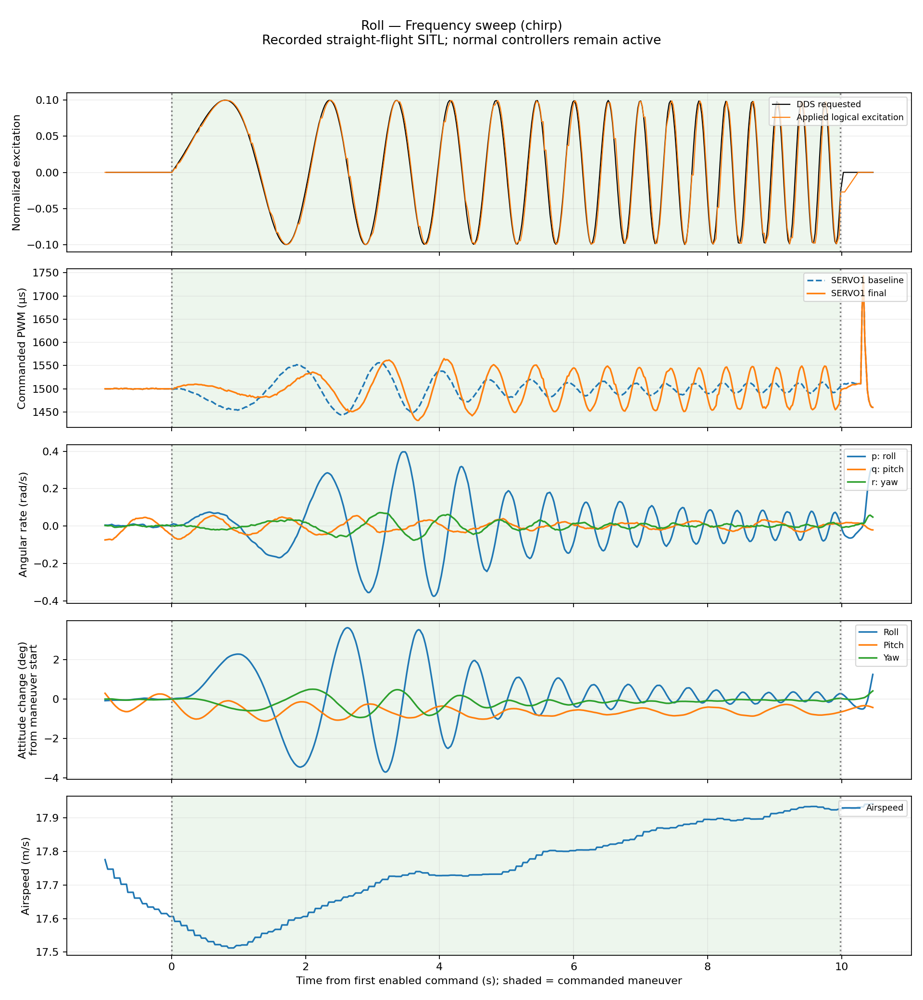

### Roll multisine

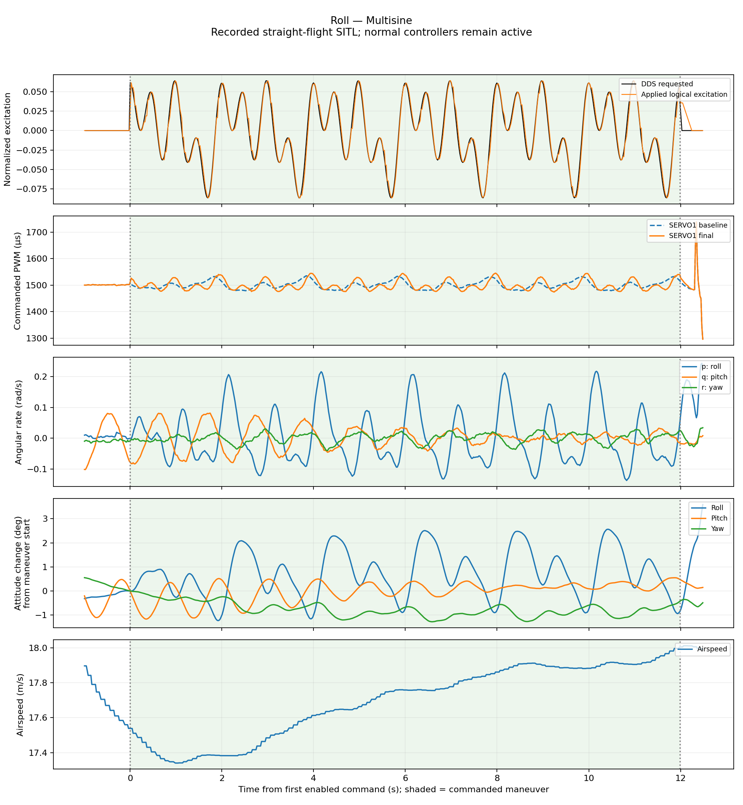

### Pitch frequency sweep

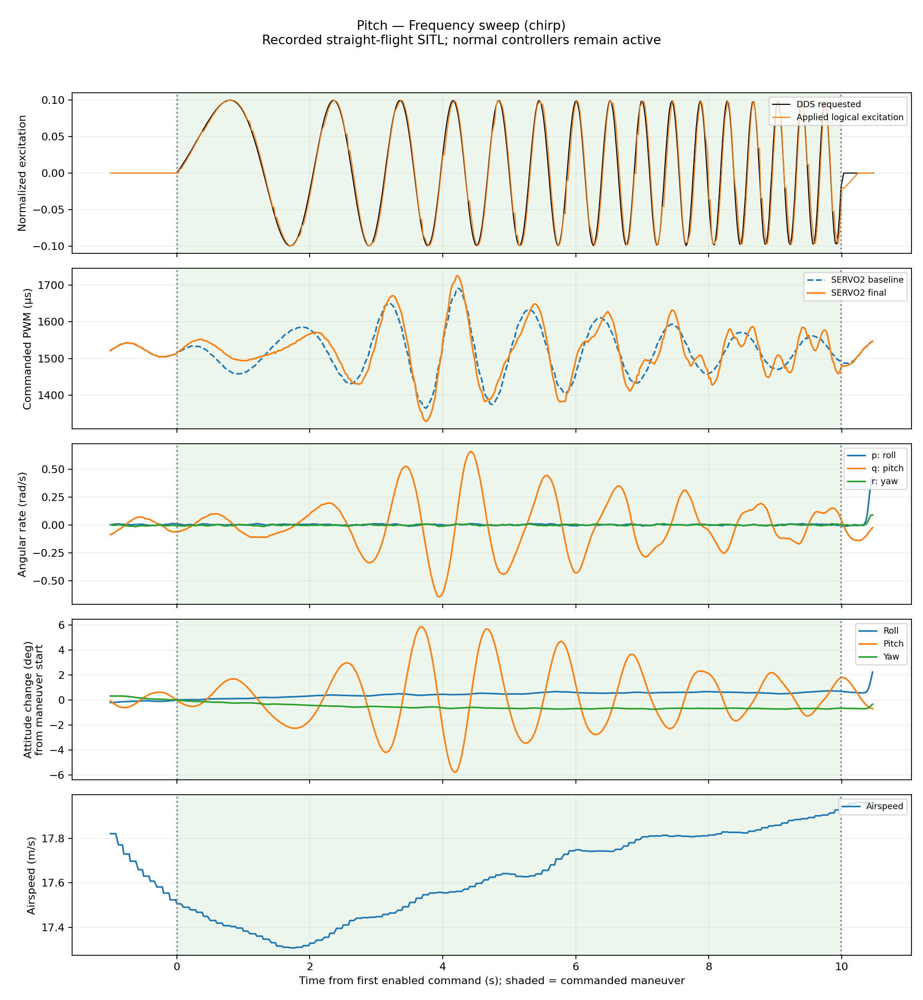

### Pitch multisine

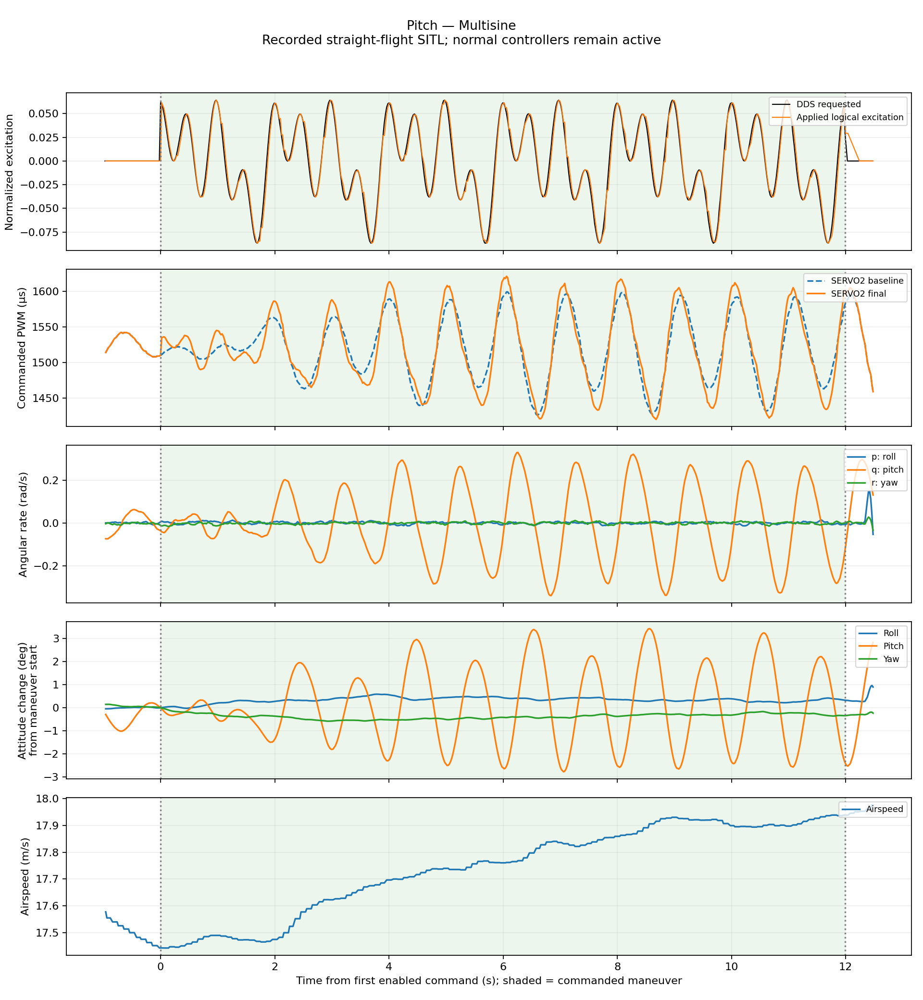

### Yaw frequency sweep

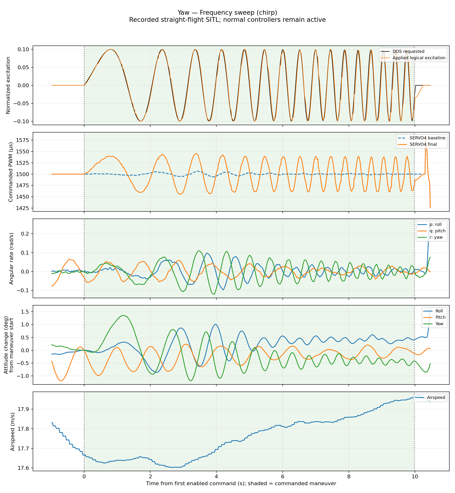

### Yaw multisine

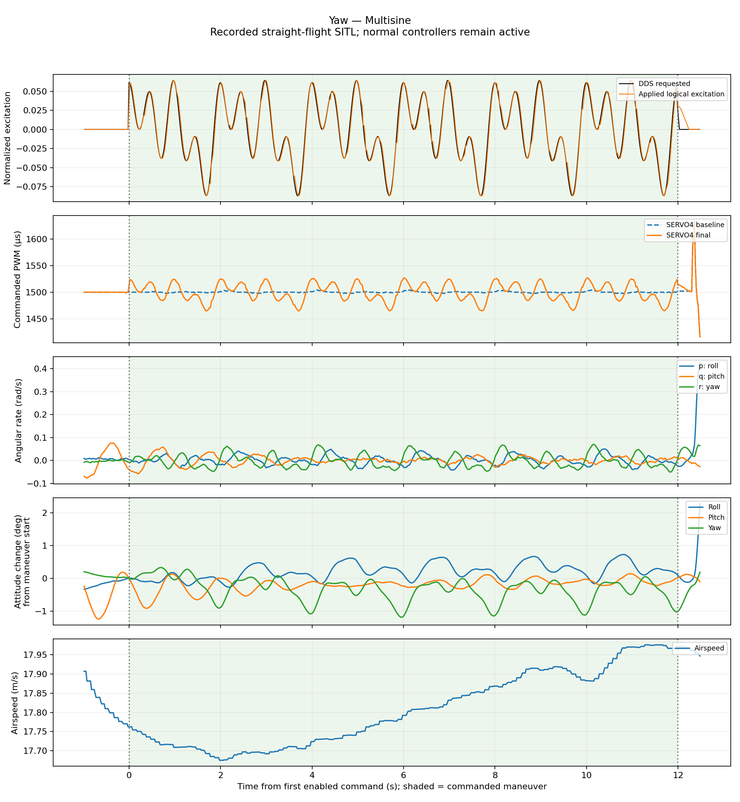

Regenerate from a sourced ROS container after rebuilding `ros2_sid`:

```bash
python3 -m ros2_sid.surface_axis_plots \
  /work/sid_results/straight_verified_20261021/rosbag \
  --command-directory /work/sid_results/straight_verified_20261021 \
  --output /work/sid_results/straight_verified_20261021/individual_axis_plots
```

The command directory must contain the six `chirp_AXIS-commands.csv` and
`multisine_AXIS-commands.csv` logs from the same bag. Windows are aligned through
the publisher's AP-clock timestamps and the bag's firmware clock/boot-time pairs.
The helper currently selects conventional aileron/elevator/rudder functions; it
does not claim mixed-surface coverage. `manifest.json` records figure names,
observed command durations, frame counts, and channel selections. All six PNG/PDF
pairs were generated successfully; the source recording's calibrated-output and
DataFlash checks are documented above.

## DDS straight-flight default update

The shared SITL/HITL DDS CLI now resolves packaged straight-flight settings by
default. `--straight-flight PATH` overrides them; `--no-straight-flight` explicitly
selects excitation-only operation without navigation targets or LOITER recovery.
The legacy trajectory interface is unchanged. The automated SITL harness explicitly
opts out when its own straight-flight switch is absent, so existing test modes keep
their intended scope.

The operator-edited configuration was preserved: it currently targets 23 m/s with
an active airspeed envelope of 20–30 m/s. The earlier flight results above used
18 m/s and are historical evidence, not verification of the changed airspeed.
The ROS package build and 21 CLI/coordinator tests passed for this default change;
no additional SITL or physical flight was run. Tests cover packaged defaults,
custom paths, opt-out, missing configuration, mutually exclusive flags, and the
existing coordination/exit behavior. The unit-test fixture now uses fixed test
speed settings rather than assuming the operator's configuration remains unchanged.

## HITL entrypoint / legacy RC gate — 2026-10-22

See the [HITL verification report](../../../ros2_sid/ros2_sid/docs/hitl_verification.md)
for six recorded per-axis chirp/multisine plots and RC timing evidence. These
runs use the HITL ROS entrypoint with simulated channel-8 input against isolated
PC SITL, not the physical Cube. The full runs passed command/output, calibrated
PWM (maximum error 1 µs), navigation recovery and safety-probe checks. The
relevant final unit/ROS suite passed 51 tests. The report separately describes
the dedicated RC-low interruption and the initial mode-channel conflict.
